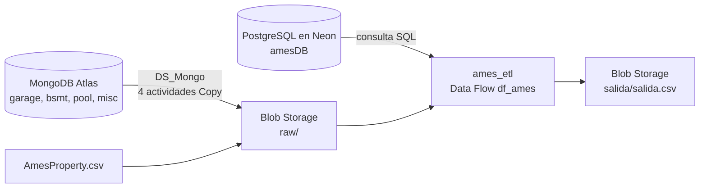
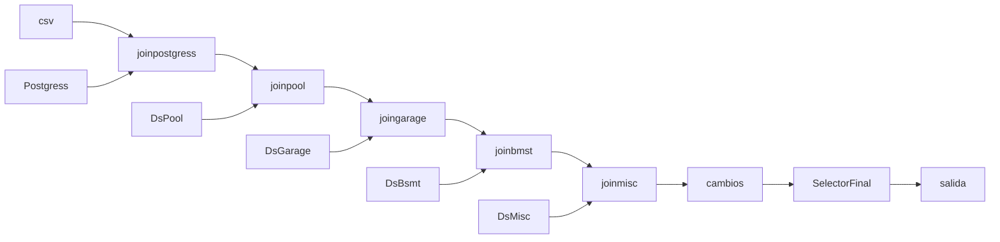

# Documentación de los pipelines de Azure Data Factory

## 1. Introducción

Por medio de Azure Data Factory (ADF) integramos tres fuentes de datos con información de las propiedades vendidas en Ames (Iowa): 1) el archivo CSV `AmesProperty.csv`, 2) la base de datos PostgreSQL `amesDB`, alojada en Neon, y 3) las colecciones `garage`, `bsmt`, `pool` y `misc` de MongoDB Atlas. Las fuentes se unen a través del identificador único de cada propiedad (`PID`).

El resultado es el archivo `out/salida.csv`, con una fila por propiedad (2.930) y 81 columnas.

Para llegar a ese resultado construimos dos pipelines:

- **`DS_Mongo`**: copia las colecciones de MongoDB al Blob Storage como archivos de texto delimitado.
- **`ames_etl`**: ejecuta el Data Flow `df_ames`, que lee las tres fuentes, las combina, aplica las transformaciones y escribe `salida.csv`.

## 2. Arquitectura y orden de ejecución

Los pipelines se ejecutan en este orden:

1. **`DS_Mongo`**, para dejar en `raw/` los archivos de las cuatro colecciones.
2. **`ames_etl`**, que lee esos archivos.

La factoría no tiene desencadenadores: los dos pipelines se ejecutan manualmente, en el orden indicado.

## 3. Servicios vinculados

Un servicio vinculado guarda la información de conexión con una fuente de datos. Las credenciales se configuran en ADF y no se guardan en este repositorio: en los archivos JSON aparecen marcadores como `<usuario>` o `<servidor>`.

| Nombre | Tipo | Uso |
|---|---|---|
| `AzurePostgreSql1` | Azure Database for PostgreSQL (versión 2.0, conexión SSL) | Base `amesDB` en Neon |
| `MongoNoSql` | MongoDB Atlas (driver v2) | Base `test` con las colecciones de MongoDB |
| `BlobStorage_Ames` | Azure Blob Storage | Contenedor `ames-etl-data`, con los archivos intermedios y la salida |

## 4. Datasets

Un dataset indica qué datos se leen o escriben dentro de una conexión.

| Dataset | Servicio vinculado | Ubicación y formato | Uso |
|---|---|---|---|
| `DS_Mongo_garage`, `DS_Mongo_bsmt`, `DS_Mongo_pool`, `DS_Mongo_misc` | `MongoNoSql` | Una colección cada uno | Origen de las Copy de `DS_Mongo` |
| `Ds_Garage`, `Ds_Bsmt`, `Ds_Pool`, `Ds_Misc` | `BlobStorage_Ames` | `raw/garage`, `raw/bsmt`, `raw/pool`, `raw/misc`; separados por coma, con encabezado | Destino de las Copy y origen del Data Flow |
| `Ds_CSV_ames` | `BlobStorage_Ames` | `raw/AmesProperty.csv`; separado por punto y coma, con encabezado | Origen del Data Flow |
| `Ds_Postgress_ames` | `AzurePostgreSql1` | La tabla la define la consulta SQL del Data Flow | Origen del Data Flow |
| `df_csv_salida` | `BlobStorage_Ames` | Carpeta `salida/`; separado por punto y coma, con encabezado | Destino del Data Flow |

## 5. Pipeline `DS_Mongo`

Copia las cuatro colecciones de MongoDB a archivos en `raw/`. Tiene cuatro actividades **Copy**, sin dependencias entre ellas, por lo que se ejecutan en paralelo:

| Actividad | Origen | Destino |
|---|---|---|
| Copy Garage | `DS_Mongo_garage` | `Ds_Garage` |
| Copy bsmt | `DS_Mongo_bsmt` | `Ds_Bsmt` |
| Copy Pool | `DS_Mongo_pool` | `Ds_Pool` |
| Copy Misc | `DS_Mongo_misc` | `Ds_Misc` |

**Asignación de columnas.** MongoDB guarda los números enteros en un formato especial (`Int64`) que ADF lee como un objeto con un subcampo `$numberLong`. Por eso, en cada Copy, la asignación toma ese subcampo y lo escribe con el nombre original del campo. Por ejemplo:

| Ruta en MongoDB | Columna en el archivo |
|---|---|
| `$['PID']['$numberLong']` | `PID` |
| `$['Garage Area']['$numberLong']` | `Garage Area` |
| `$['Garage Type']` | `Garage Type` |

El campo `_id` de MongoDB no se copia, porque solo es un identificador interno de la base. Los documentos incompletos se copian igual: los campos que faltan quedan vacíos en el archivo.

## 6. Pipeline `ames_etl`

Tiene una sola actividad, **`ETL`**, de tipo *Data Flow*, que ejecuta `df_ames`. Usa cómputo de tipo General con 8 núcleos, sin reintentos y con un tiempo máximo de 12 horas.

## 7. Data Flow `df_ames`

### 7.1 Orígenes

| Origen | Dataset | Contenido |
|---|---|---|
| `csv` | `Ds_CSV_ames` | 19 columnas generales de la propiedad |
| `Postgress` | `Ds_Postgress_ames` | Resultado de una consulta SQL sobre `amesDB` (sección 7.2) |
| `DsGarage`, `DsBsmt`, `DsPool`, `DsMisc` | `Ds_Garage`, `Ds_Bsmt`, `Ds_Pool`, `Ds_Misc` | Archivos copiados por `DS_Mongo` |

En todos los orígenes, `PID` se lee como entero largo (`long`), para que las uniones comparen el mismo tipo de dato.

### 7.2 Consulta SQL a PostgreSQL

La parte relacional se resuelve con una consulta SQL en el origen `Postgress`. La consulta parte de `amesdbtemp` y hace lo siguiente dentro de la base de datos:

| Transformación | Cómo se hace |
|---|---|
| Totales de baños y habitaciones | Suma `bedrooms`, `Full Bath` y `Half Bath` de `floordetail` agrupando por `pid`, y une el resultado. Así se obtiene una fila por propiedad aunque tenga varios pisos |
| Zonificación | Une `mszoning` para cambiar el id de `MS Zoning` por su código (por ejemplo, `RL`) |
| Calidades | Une `typequality` cuatro veces para cambiar los ids de `Exter Qual`, `Exter Cond`, `Heating QC` y `Kitchen Qual` por su código (`Ex`, `Gd`, `TA`, `Fa`, `Po`) |
| Datos de venta | Une `saleproperty` y extrae el mes (`Mo Sold`) y el año (`Yr Sold`) de `Sale Date` |
| `Gr Liv Area` | Suma `1st Flr SF` + `2nd Flr SF` + `Low Qual Fin SF` |
| `Central Air` | Convierte el valor verdadero/falso en `Y` / `N` |
| Valores faltantes | Reemplaza los vacíos de `Mas Vnr Type` y `Electrical` por `NA`, y los de `Mas Vnr Area` por 0 |

### 7.3 Uniones

Todas las uniones son **externas izquierdas** y usan `csv@PID` como llave. El CSV es la tabla base, de modo que se conservan las 2.930 propiedades aunque no tengan documento en alguna colección de MongoDB:

1. `joinpostgress`: CSV con el resultado de la consulta SQL.
2. `joinpool`: con `DsPool`.
3. `joingarage`: con `DsGarage`.
4. `joinbmst`: con `DsBsmt`.
5. `joinmisc`: con `DsMisc`.

### 7.4 Transformaciones (`cambios`)

| Columna(s) | Transformación |
|---|---|
| `Year Remod/Add` | Si está vacía, toma el valor de `Year Built` |
| Cualitativas de MongoDB: `Garage Type`, `Garage Finish`, `Garage Qual`, `Garage Cond`, `Bsmt Qual`, `Bsmt Cond`, `Bsmt Exposure`, `BsmtFin Type 1`, `BsmtFin Type 2`, `Pool QC`, `Misc Feature` | Si están vacías, `NA` |
| Numéricas de MongoDB: `Garage Yr Blt`, `Garage Cars`, `Garage Area`, `BsmtFin SF 1`, `BsmtFin SF 2`, `Bsmt Unf SF`, `Total Bsmt SF`, `Bsmt Full Bath`, `Bsmt Half Bath`, `Pool Area`, `Misc Val` | Si están vacías, 0 |
| `Lot Frontage` | Si está vacía, 0 |
| `Lot Shape` | Descripción a código: `Regular` → `Reg`, `Slightly irregular` → `IR1`, `Moderately Irregular` → `IR2`, `Irregular` → `IR3` |
| `Neighborhood` | Descripción a código según la tabla del enunciado; por ejemplo, `College Creek` → `CollgCr` y `North Ames` → `Names`. Los valores que ya vienen como código se conservan |
| `Condition 1` y `Condition 2` | Descripción a código; por ejemplo, `Normal` → `Norm` y `Adjacent to feeder street` → `Feedr`. Los valores que ya vienen como código se conservan |
| `Sale Type` | Se eliminan los espacios sobrantes; por ejemplo, `WD ` → `WD` |

La regla de NA y 0 cubre dos casos: las propiedades sin documento en una colección y los campos que faltan dentro de un documento.

### 7.5 Selección final (`SelectorFinal`)

Deja las 81 columnas de la salida, en el orden del enunciado, y las renombra en *snake case*, sin espacios. Conserva en mayúsculas `PID`, `MS` y `QC`; por ejemplo, `MS_sub_class`, `heating_QC` y `pool_QC`. También descarta las columnas `PID` repetidas que dejan las uniones y conserva la del CSV.

### 7.6 Destino (`salida`)

Escribe en el dataset `df_csv_salida` un único archivo llamado `salida.csv`, con una sola partición, separado por punto y coma y con encabezado. La versión final de ese archivo está en el repositorio en `out/salida.csv`.

## 8. Verificación del resultado

Al revisar `out/salida.csv` se obtuvo:

| Comprobación | Resultado |
|---|---|
| Filas y columnas | 2.930 filas y 81 columnas |
| `PID` | 2.930 valores únicos |
| Nombres de columna | Ninguno con espacios |
| Celdas vacías | Ninguna |
| `garage_type` = `NA` | 157 propiedades sin garage |
| `pool_QC` = `NA` | 2.917 propiedades sin piscina |
| `misc_feature` = `NA` | 2.824 propiedades sin características adicionales |
| `garage_yr_blt` = 0 | 159 (157 sin garage y 2 garages sin año registrado) |
| `lot_frontage` = 0 | 490 |

La validación completa se hace con el notebook `notebooks/validar_salida_ames.ipynb`.

## 9. Archivos de esta carpeta

| Ruta | Contenido |
|---|---|
| `pipeline/` | Definición JSON de `DS_Mongo` y `ames_etl` |
| `dataflow/` | Definición del Data Flow `df_ames` en JSON y en script (`df_ames.dsl`) |
| `dataset/` | Definición de los datasets |
| `linkedService/` | Definición de los servicios vinculados, sin credenciales |
| `arm_template/` | Plantilla ARM exportada desde ADF para volver a desplegar la factoría `practicaETLFinalJV` |

La plantilla ARM incluye además un servicio vinculado `PostgreSql` y un dataset `Ds_Postgres` que no usan los pipelines descritos en este documento.
